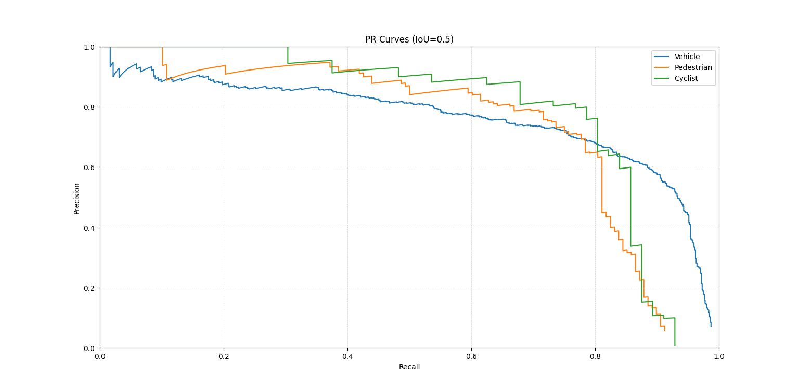
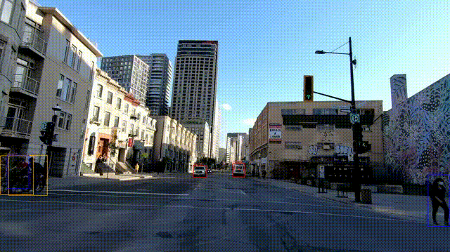

## RT-DETR KITTI (3 classes)

This repo trains and evaluates RT-DETR on KITTI with 3 classes: Vehicle, Pedestrian, Cyclist.

### Why RT-DETR

RT-DETR is a strong real-time detector that balances speed and accuracy. It uses a DETR-style transformer decoder with fast convolutional backbones and multi-scale features. This fits the project goal: single-stage, end-to-end detection with clean outputs and a stable training pipeline.

We start from the public checkpoint `PekingU/rtdetr_r50vd_coco_o365` and fine-tune it on KITTI. This gives a good initialization for driving scenes while keeping the model light enough for video demos.

## Setup

Install dependencies:

```bash
pip install -r requirements.txt
```

## Data

Follow the dataset download and preprocessing steps in [data/README.md](data/README.md).

After preprocessing, you should have:

```
data/processed/train
data/processed/val
data/processed/test
```

## Train

Training configuration:
The defaults live in [configs/train.yaml](configs/train.yaml)

- **Batch size:** 8 with `gradient_accumulation_steps=4` (effective batch size 32).
- **Learning rate:** 1e-4 for the head, with `backbone_lr_factor=0.1` for the backbone.
- **Scheduler:** cosine with `warmup_ratio=0.1`.
- **Regularization:** `weight_decay=1e-4`, `max_grad_norm=0.1`.
- **Checkpointing:** eval/save each epoch, keep the best model by eval loss.

The model head is reinitialized for 3 classes (Xavier init + prior bias) so it learns quickly from scratch while preserving pretrained features in the backbone.

Training:

```bash
cd scripts
python train.py
```

Checkpoints are saved to:
results/

## Evaluation (mAP)

Overall mAP for fine-tuned checkpoint and base model:

```bash
cd scripts
python eval.py --top-k 100 --max-samples 200
```

Notes:
- `--top-k` controls how many predictions per image are evaluated.
- `--max-samples` limits evaluation to a subset for quick checks.

## Error Analysis

Random sample with threshold:

```bash
cd scripts
python error_analysis.py --threshold 0.01
```

This draws ground-truth (left) and predictions (right) for one validation image.

Top-k predictions:

```bash
python error_analysis.py --top-k 2
```

This ignores the threshold and always shows the top-k predictions.

Per-class AP + PR curves:

```bash
python error_analysis.py --pr --max-samples 200
```

This prints per-class AP and plots the precision-recall curves (IoU=0.5).

Save PR curve:

```bash
python error_analysis.py --pr --pr-save pr_curve.png
```

This saves the PR curve plot in the current directory.

## Results

- mAP@0.5: 0.7684 (Compared to 0.4581 from the base model)
- mAP@0.5:0.95: 0.4475 (Compared from 0.2430 from the base model)


We can also see the precision-recall curve:


## Video

Run inference on a video from data/videos and save output to reports/:

```bash
cd scripts
python demo_video.py --threshold 0.045
```

Optional arguments:

```bash
python demo_video.py --video ../data/videos/your_video.mp4 --threshold 0.045
python demo_video.py --checkpoint ../results/checkpoint-XXXX --output ../reports/out.mp4
python demo_video.py --threshold 0.045 --show-score
```

The video below was created using a threshold of 0.045 after analyzing the precision–recall curve.

Preview (trimmed for GitHub):

